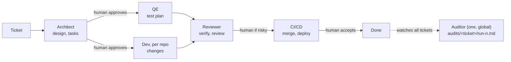

# Design

## Idea

- A ticket triggers one **run**. A run is not a fixed pipeline: **agents** (roles) work from shared **artifacts**.
- An agent starts when its input artifacts are ready, not when "the previous step" ends. Agents never call each other.
- Artifact statuses: `missing, draft, ready, approved, rejected, stale`. Agent states are derived from them.
- A changed input makes everything built from it **stale**, and those agents run again by themselves.
- People decide at a few **gates**. Everything else runs unattended.

Hierarchy: PI planning, topic PRD, ticket, run. If the PRD changes or a ticket is rejected, a new run starts.

## Agent contracts

> Naming: roles are called agents (`agents:` in `config/agents.yaml`, `--agent` on commands). Configs, manifests and event logs written with the old name "lane" (`lanes.yaml`, `lanes:`, `lane_*` events, `--lane`) are still read.

`config/agents.yaml` is the single source of truth, and the code has no agent names in it: every script and the playbook read
the agents through `scripts/wf_config.py`. Per agent: `requires`, `produces`, an optional `gate`, and `fan_out: repo`. Per kind:
which agents run, per-agent `overrides`, `deploy`, `accept_when`. `@approved` means a human gate passed.

- **Artifacts** of a run = the system artifacts (`ticket-context.md`) plus everything its agents produce. `name/<repo>/` is one folder per repo.
- **Built from** (for staleness) = the producing agent's `requires`, unless `artifact_inputs` says otherwise.
- **Gates**: `artifacts` approved together; `when: risk_flagged` (only if the agent's report says `human_required: true`, read from `decision_in`);
  `sets_repos_from` (on approval, copy the repos and Release section from that artifact into the manifest); `feedback_to` (on rejection,
  write the reason into that artifact so the agent redoes the work).
- **Events** agents may raise (`events:`): who may raise each one and which artifacts it sends back for rework. `question_raised` and `escalate` are built in.
- **Adapting per kind**: when a kind leaves out the agent that produces something another agent needs, that need is skipped for the kind
  (`python scripts/wf_config.py` lists these as notes). A name that no agent produces anywhere is reported as a problem.
- **Instructions per agent**: `instructions` (default `wf-<name>`, the file `.github/agents/<instructions>.agent.md`), optional `model` and `args`.
- **Done condition per kind** (`done_when`): every agent done and every gate passed, then optionally more `artifacts` at a status,
  `deploy` (CI/CD deploys the run's repos), and `person_accepts` (a person accepts at the end; without it the ticket is Done by itself).
- **Ticket status** is generic: Escalated, Needs input, Done, Awaiting approval (a gate), else the `stage` of the first unfinished agent,
  then Finishing (waiting for `done_when` artifacts), Deploying and Awaiting acceptance.
- **Changing the config** applies to every ticket's derived status at once; new tickets get the new agents in their manifest; a running
  workflow picks up a new agent when it is started or resumed.

Default configuration:

| Agent | Needs | Produces |
|---|---|---|
| Architect (`planner`) | `ticket-context.md` | `design.md`, `tasks.md` (gate: human approves both) |
| QE | `ticket-context.md`, `tasks.md@approved` | `test-plan.md` (and untracked `tests/<repo>/`) |
| Dev, per repo (repos listed in `tasks.md`) | `ticket-context.md`, `design.md@approved`, `tasks.md@approved` | `changes/<repo>/` |
| Reviewer | `changes/*`, `test-plan.md` | `verify-report.md`, `review-report.md` (gate when `human_required`) |

The ticket already carries its acceptance criteria and scenarios (from refinement, in a fixed template: `J-n`, or `C-n` for a chore), so there is no spec step: `ticket-context.md` is the spec. A ticket without criteria or without an affected repo is refused at `wf_run.py ready` (send it back to refinement, or `--force`). The Architect checks the criteria are testable and raises a question to the ticket owner if not; the owner's answer is written into `ticket-context.md` under `## Clarifications`, so every agent reads it (only for the first agent, before anything is built from the ticket), decides the design, splits the work per repo and lists in `tasks.md` which criteria each task covers (`wf_status.py` warns about an uncovered one).

The Reviewer is independent of Dev and QE. The Reviewer's `human_required` decision follows `config/risk-rules.yaml`.

## The Auditor (global, not a ticket agent)

One Auditor serves all tickets. It is not one of the ticket agents: its config is `config/auditor.yaml` (agent, model, `audit_when`
statuses, `poll_seconds`, `auto_start`), also editable on the Configure page. It does not start by default: a person starts
and stops it (playbook Auditor card, or `scripts/wf_audit.py watch`), or `auto_start: true` starts it with the playbook.
While it runs it polls every ticket; when a run's status is in `audit_when` and it has no audit yet, it runs one agent
session that reads the run (`events.log`, `decisions.md`, `logs/`, `artifacts/`) and writes `audits/<ticket>/run-<n>.md`.
Its own trail is `audits/events.log`. It never writes to a ticket, has no gate and no effect on ticket status. A failed
audit is retried up to `max_attempts`; **Audit again** (or `wf_audit.py audit --ticket T`) audits a run again.

## Who writes what

- **Agents** write artifacts, and append an event to `events.log` only to report a problem: `question_raised`, `design_gap`, `verify_failed`, `review_rejected`, `escalate`. Rules: `skills/_common.md`.
- **The orchestrator** (`scripts/wf_run.py`, one worker per agent) is the only writer of `manifest.yaml`. It marks artifacts ready with the hashes of their inputs, applies the events, and enforces one session per agent instance (lease) and `max_attempts`.
- **People** use commands: `approve`, `reject`, `answer`, `accept`, `retry`.

## Ticket status (derived)

Planning, Building, Verifying, In review, Deploying, Awaiting acceptance, Done, Needs input, Escalated.
`python scripts/wf_status.py <TICKET>` prints it with every agent, every artifact and the next action. It never writes.

## When things go wrong

| Situation | What happens |
|---|---|
| Verify fails for one repo | `verify_failed` rejects that repo's `changes`; only its Dev instance reruns; the verify report goes stale and the Reviewer reruns |
| Design or tasks are wrong or incomplete | `design_gap` sends `design.md` and `tasks.md` back to the Architect; everything built from them goes stale |
| A ticket criterion is unclear or untestable | `question_raised` blocks that agent; the ticket owner answers (`wf_run.py answer`). The Architect never rewrites the ticket's criteria |
| Agent needs an answer | `question_raised` blocks that agent only; `wf_run.py answer` unblocks it and the answer goes into its next task message |
| A session crashes or writes nothing | it is retried; after `max_attempts` the agent fails and the ticket is Escalated; `retry` gives a fresh budget |
| An agent keeps sending work back | each `design_gap` / `verify_failed` / `review_rejected` round counts; after `per_run.max_reworks` (default 3, `config/budgets.yaml`) the agent fails and the ticket is Escalated; `retry` resets the count |

## Multiple repos

The Architect lists repos in `tasks.md`; one Dev instance runs per repo. `tasks.md` ends with a Release section: `deploy_order: independent` or `ordered` (with `sequence:`). CI follows it and stops at the first failure. Repo names should match `config/repos.yaml`, which holds each repo's `remote`, `default_branch`, `deploy` and `local_path` in one file (a relative `local_path` is under `$WF_REPOS_ROOT`, or next to the workflow folder; an optional git-ignored `config/repos.local.yaml` overrides paths on one machine). Paths are passed to agents only if the folder exists.

**One writer per repo.** A Dev instance takes a lock on its repo (`locks/<repo>.json`, shared by all tickets) for the length of its session. Another ticket's Dev instance for the same repo waits ("waiting for repo X") and starts when it is free; a lock left by a crashed worker expires with its lease.

## Placeholders for the team to improve

- **Every agent file** (`.github/agents/wf-*.agent.md`): replace the section "TEAM: replace this with the real task". Keep the output artifacts and the MACHINE parts of the templates.
- **Deploy**: `deploy.command` in `config/runner.yaml` (today it only prints).
- **Cross-repo tests** (QE) and **release order / rollback** (Dev): see `placeholders` in `config/agents.yaml`.
- **Acceptance policy**: still TBD (`acceptance` block in the manifest); today a person runs `accept`.
- **Risk rules and attempt limits**: `config/risk-rules.yaml`, `config/budgets.yaml`.
