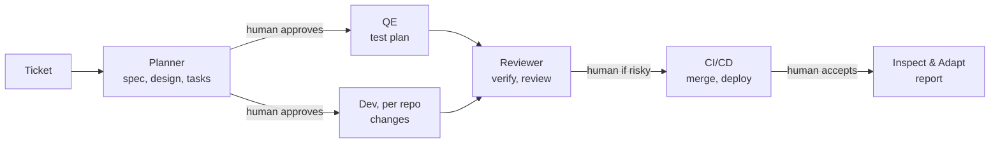

# Design

## Idea

- A ticket triggers one **run**. A run is not a fixed pipeline: **lanes** (roles) work from shared **artifacts**.
- A lane starts when its input artifacts are ready, not when "the previous step" ends. Lanes never call each other.
- Artifact statuses: `missing, draft, ready, approved, rejected, stale`. Lane states are derived from them.
- A changed input makes everything built from it **stale**, and those lanes run again by themselves.
- People decide at a few **gates**. Everything else runs unattended.

Hierarchy: PI planning, topic PRD, ticket, run. If the PRD changes or a ticket is rejected, a new run starts.

## Lane contracts

`config/lanes.yaml` is the single source of truth: what each lane `requires` and `produces`, the gates, and which artifact is built from which (`artifact_inputs`). `@approved` means a human gate passed.

| Lane | Needs | Produces |
|---|---|---|
| Planner | `ticket-context.md` | `spec.md`, `design.md`, `tasks.md` (gate: human approves all three) |
| QE | `spec.md@approved`, `tasks.md@approved` | `test-plan.md`, `tests/` |
| Dev, per repo (repos listed in `tasks.md`) | `spec.md`, `design.md`, `tasks.md` approved | `changes/<repo>/` |
| Reviewer | `changes/*`, `test-plan.md` | `verify-report.md`, `review-report.md` (gate when `human_required`) |
| Inspect & Adapt | `events.log`, all artifacts | `inspection-report.md` |

The Reviewer is independent of Dev and QE. The Reviewer's `human_required` decision follows `config/risk-rules.yaml`.

## Who writes what

- **Agents** write artifacts, and append an event to `events.log` only to report a problem: `question_raised`, `spec_gap`, `verify_failed`, `review_rejected`, `escalate`. Rules: `skills/_common.md`.
- **The orchestrator** (`scripts/wf_run.py`, one worker per lane) is the only writer of `manifest.yaml`. It marks artifacts ready with the hashes of their inputs, applies the events, and enforces one session per lane instance (lease) and `max_attempts`.
- **People** use commands: `approve`, `reject`, `answer`, `accept`, `retry`.

## Ticket status (derived)

Planning, Building, Verifying, In review, Deploying, Awaiting acceptance, Done, Needs input, Escalated.
`python scripts/wf_status.py <TICKET>` prints it with every lane, every artifact and the next action. It never writes.

## When things go wrong

| Situation | What happens |
|---|---|
| Verify fails for one repo | `verify_failed` rejects that repo's `changes`; only its Dev instance reruns; the verify report goes stale and the Reviewer reruns |
| Spec is unclear | `spec_gap` sends `spec.md` back to the Planner; everything built from it goes stale |
| Agent needs an answer | `question_raised` blocks that lane only; `wf_run.py answer` unblocks it and the answer goes into its next task message |
| A session crashes or writes nothing | it is retried; after `max_attempts` the lane fails and the ticket is Escalated; `retry` gives a fresh budget |

## Multiple repos

The Planner lists repos in `tasks.md`; one Dev instance runs per repo. `tasks.md` ends with a Release section: `deploy_order: independent` or `ordered` (with `sequence:`). CI follows it and stops at the first failure. Repo names should match `config/repos.yaml`; local paths go in `config/repos.local.yaml` (git-ignored) and are passed to agents only if known.

## Placeholders for the team to improve

- **Every agent file** (`.github/agents/wf-*.agent.md`): replace the section "TEAM: replace this with the real task". Keep the output artifacts and the MACHINE parts of the templates.
- **Deploy**: `deploy.command` in `config/runner.yaml` (today it only prints).
- **Cross-repo tests** (QE) and **release order / rollback** (Dev): see `placeholders` in `config/lanes.yaml`.
- **Acceptance policy**: still TBD (`acceptance` block in the manifest); today a person runs `accept`.
- **Risk rules and attempt limits**: `config/risk-rules.yaml`, `config/budgets.yaml`.
